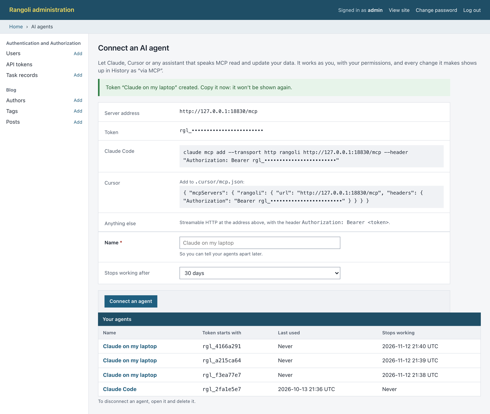

# Rangoli

**Give your Django data to Claude. Not your database.**

Django's admin, ORM and API, rebuilt in Rust. AI agents connect as a user you control.



[16-second demo](site/ai-agent-demo.mp4) · [Website](https://harshil-jani.github.io/rangoli-rs/) · [Guides](docs/howto) · [Full reference](docs/REFERENCE.md)

## Try it on your Django database

```sh
git clone https://github.com/Harshil-Jani/rangoli-rs && cd rangoli-rs
RANGOLI_DATABASE_URL=postgres://user:pw@host/your_django_db cargo run -p rangoli-django
```

1. Open `/admin/` and sign in with your Django staff account.
2. Click **Connect an AI agent**.
3. Paste the line it gives you into Claude Code or Cursor. For claude.ai, paste the server address as a custom connector instead.

Nothing in your Django database changes.

## Safe by default

- **Read-only.** Agents can't change anything until you allow it.
- **You approve.** Changes can wait for a person, and every change can be undone.
- **Secrets stay put.** Private columns never leave the server.
- **Only their rows.** One rule decides what each user and agent can see.
- **Everything is logged.** Every change shows in History as "via MCP".

## Faster, lighter

| | Rangoli | Django 6.1 |
|---|---|---|
| 50 posts as JSON | **14,416 req/s** | 1,961 req/s |
| Admin list page | **2,777 req/s** | 169 req/s |
| Memory under load | **54 MB** | 628 MB |
| Startup | **19 ms** | 314 ms |

It's also **1.3–3.1× faster than [django-bolt](bench/vs_bolt/RESULTS.md)** on django-bolt's own benchmark, and rechecked on GitHub's servers every week. Same app, same data, same machine; [how we measured](https://harshil-jani.github.io/rangoli-rs/report.html).

## What's included

Admin · typed ORM · JSON API with OpenAPI · MCP server for AI agents · background jobs and cron · WebSockets and SSE · webhooks · 2FA · JWT and OAuth sign-in · row-level permissions · full-text search · S3 uploads · self-clearing cache · CSV import and export · encrypted fields · zero-downtime migrations

All in one binary, with no Celery, no Redis and no extra services.

## Start a new project

```sh
cd examples/blog
cargo run -- migrate && cargo run -- createsuperuser admin
RANGOLI_DEBUG=1 cargo run    # http://127.0.0.1:8000/admin/
```

More examples: [helpdesk](examples/helpdesk) (AI agent on a support queue) · [api_only](examples/api_only) · [rangoli-django](examples/django/src/main.rs)

## Status

Early, but tested end to end on Postgres, MySQL and SQLite on every push. See [what's not done yet](docs/REFERENCE.md#whats-not-done-yet) and the [roadmap](docs/ROADMAP.md).

MIT or Apache-2.0.
